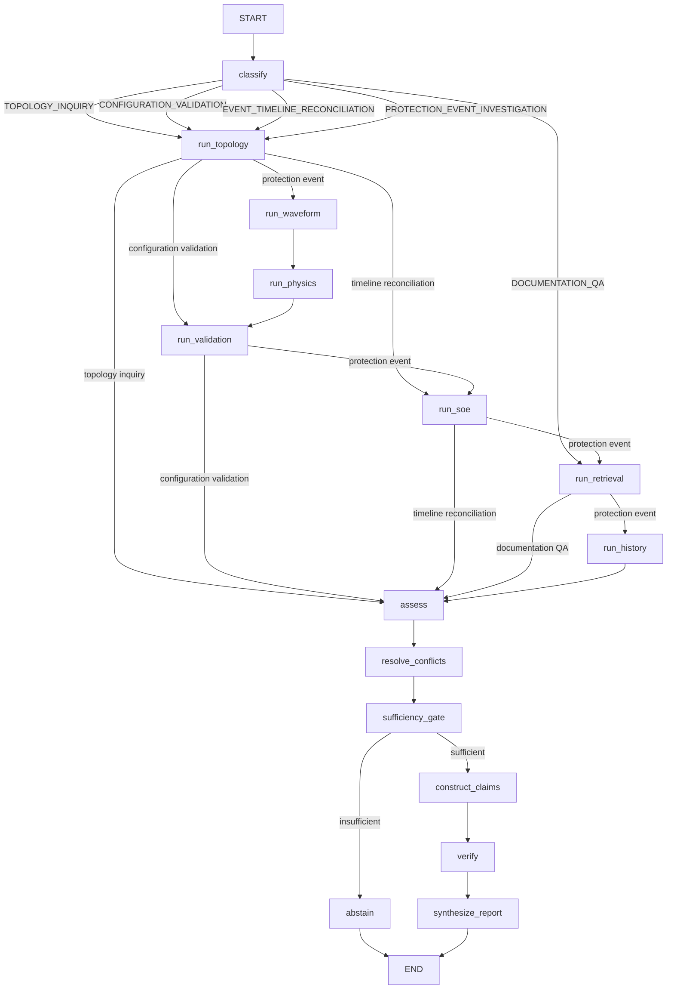

# Architecture

GridLens runs an investigation as a typed, auditable workflow over deterministic
domain services. Measurements and equipment facts enter the report only through
the evidence ledger and claim-verification pipeline. The registered graph and
node implementations live in [`services/agent/graph.py`](../services/agent/graph.py).

## Investigation graph



The graph registers 15 nodes in this order:

1. `classify` — classify intent and select tools.
2. `run_topology` — resolve feeder, bay, relay, breaker, IED, and channel context.
3. `run_waveform` — parse and analyze the COMTRADE recording.
4. `run_physics` — perform deterministic sequence/pickup and settings analysis.
5. `run_validation` — apply wiring and configuration rules.
6. `run_soe` — reconcile sequence-of-events timing.
7. `run_retrieval` — retrieve and cite local technical references.
8. `run_history` — correlate the seeded three-record history.
9. `assess` — score evidence against hypotheses.
10. `resolve_conflicts` — apply the allowlisted cross-source resolution rule.
11. `sufficiency_gate` — decide whether evidence supports a report.
12. `abstain` — emit a deterministic insufficient-evidence result.
13. `construct_claims` — construct candidate facts, inferences, and recommendations.
14. `verify` — verify candidate claims against their cited evidence.
15. `synthesize_report` — format the verified result.

There are five intent-routed pipelines: full protection-event investigation,
topology inquiry, documentation QA, configuration validation, and event-timeline
reconciliation. If LangGraph is unavailable, the same stages run through the
documented linear fallback executor in
[`GridLensInvestigationWorkflow._run_investigation_linear`](../services/agent/graph.py).

`InvestigationGraphState` is a 33-key `TypedDict` in the current implementation.
Every registered node is wrapped by `_trace_stage`, which appends an
`AuditTraceEntry` with inputs, output summary, and duration to the execution
trace. The state shape and decorator are intentionally part of the audit
contract, not an opaque framework detail.

## Components

| Component | Responsibility |
| --- | --- |
| [FastAPI service](../apps/api/main.py) | Request validation, authentication, authorization, CORS, and API routing. |
| [Investigation workflow](../services/agent/graph.py) | Executes the 15 graph nodes, or the linear fallback, and records the trace. |
| [COMTRADE service](../services/comtrade/) | Parses the supported ASCII subset and calculates normalized measurements. |
| [Physics service](../services/physics/) | Calculates sequence components, pickup margins, and scoped counterfactuals. |
| [Topology service](../services/graph/) | Resolves equipment relationships from the seeded directed graph. |
| [Validation service](../services/validation/) | Applies wiring and configuration rules. |
| [SOE service](../services/soe/) | Orders events and derives relative timing. |
| [Retrieval service](../services/retrieval/) | Searches the local technical corpus with BM25/LSA fusion and verifies quotations. |
| [Evidence ledger](../domain/evidence/) | Stores typed facts with source and tool provenance. |
| [Claim verifier](../services/agent/verifier.py) | Accepts supported facts and inferences and rejects mismatches. |
| [Report generator](../services/agent/report_generator.py) | Formats accepted claims without changing their values. |

## Provenance path

The implemented provenance chain is:

```text
source
  -> typed tool result
  -> evidence record
  -> evidence assessment
  -> fact or inference
  -> verification result
  -> report
```

Facts must match a typed tool result. Inferences must cite verified premises and
an implemented inference rule. Recommendations are stored separately from
observations. The claim verifier and report generator enforce this boundary in
[`services/agent/verifier.py`](../services/agent/verifier.py) and
[`services/agent/report_generator.py`](../services/agent/report_generator.py).

## Storage and process scope

The included implementation uses:

- seeded JSON for topology, incidents, and the three-record history;
- COMTRADE CFG/DAT files for waveform records;
- local Markdown with BM25/LSA retrieval for technical references; and
- in-memory investigation and approval state.

The investigation cache and approval state are per-process. This is a
single-process demo scope: there is no persistence or horizontal scaling.
Repository interfaces isolate storage access; SQLite, Redis, Postgres, Neo4j,
and pgvector adapters are not included.

## Failure behavior

- Unsupported or malformed COMTRADE input is rejected by the parser.
- Missing required evidence produces an insufficient-evidence result.
- Conflicting sources remain explicit until a validation rule resolves them.
- Failed claim verification removes the claim from the report.
- Provider errors fall back to the deterministic report path and are recorded.

See [`verification.md`](verification.md) for input limits and evaluation
coverage, and [`security.md`](security.md) for deployment boundary conditions.
