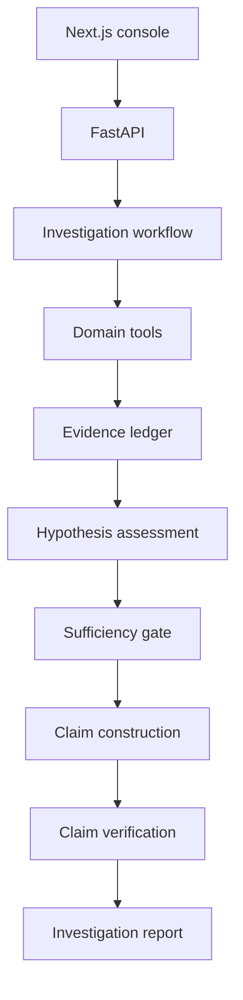

# Architecture

GridLens runs an investigation as a fixed workflow over typed domain services.
Measurements and equipment facts enter the report only through the evidence and
claim-verification pipeline.



## Components

| Component | Responsibility |
| --- | --- |
| FastAPI service | Request validation, authentication, authorization, and API routing. |
| Investigation workflow | Executes the investigation nodes and records the trace. |
| COMTRADE service | Parses recordings and calculates normalized measurements. |
| Physics service | Calculates sequence components, pickup margins, and counterfactuals. |
| Topology service | Resolves equipment relationships from the seeded directed graph. |
| Validation service | Applies wiring and configuration rules. |
| SOE service | Orders events and derives relative timing. |
| Retrieval service | Searches the local technical corpus and verifies quotations. |
| Evidence ledger | Stores typed facts with source and tool provenance. |
| Claim verifier | Accepts supported facts and inferences and rejects mismatches. |
| Report generator | Formats accepted claims without changing their values. |

## Provenance path

```text
source
  -> typed tool result
  -> evidence record
  -> evidence assessment
  -> fact or inference
  -> verification result
  -> report
```

Facts must match a typed tool result. Inferences must cite verified premises and
an implemented inference rule. Recommendations are stored separately from
observations.

## Storage

The included implementation uses:

- seeded JSON for topology and incidents;
- COMTRADE CFG/DAT files for waveform records;
- local Markdown with BM25/LSA retrieval for technical references; and
- in-memory investigation and approval state.

Repository interfaces isolate storage access. Neo4j and pgvector adapters are
not included.

## Failure behavior

- Unsupported or malformed COMTRADE input is rejected by the parser.
- Missing required evidence produces an insufficient-evidence result.
- Conflicting sources remain explicit until a validation rule resolves them.
- Failed claim verification removes the claim from the report.
- Provider errors fall back to the deterministic report path and are recorded.

See [verification.md](verification.md) for input limits and evaluation coverage.
